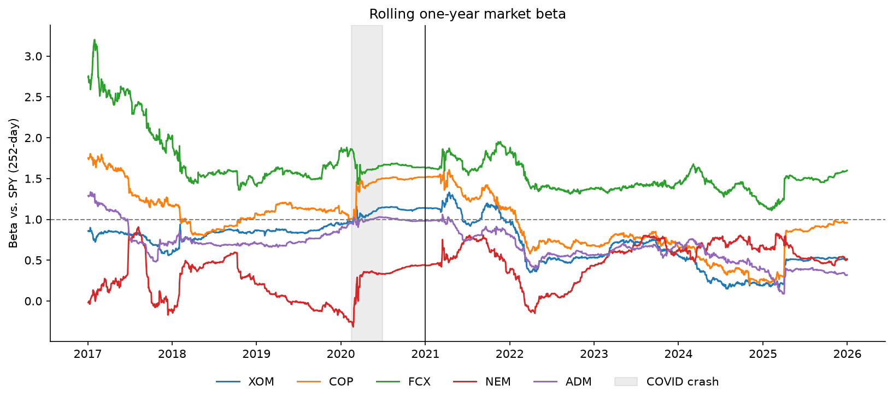
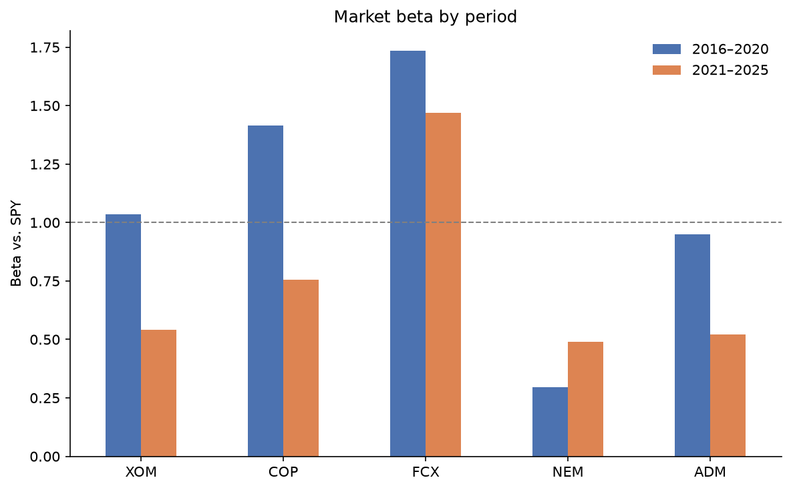
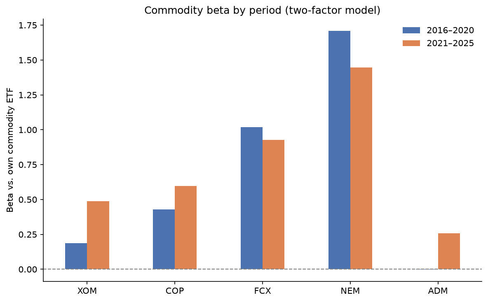

# Commodity Stocks vs. the S&P 500: Did Market Exposure Change After 2020?

I wanted to know how much of an oil, mining, or farm stock's daily return comes from the stock market and how much comes from its commodity, and whether that changed after 2020. I looked at five stocks from 2016 to 2025:

- Oil: XOM and COP, with USO for oil
- Copper: FCX, with CPER
- Gold: NEM, with GLD
- Agriculture: ADM, with DBA

SPY stands in for the market, and the risk-free rate is the 13-week T-bill (`^IRX`).



## What I found

Market beta fell after 2020 for four of the five stocks. XOM went from 1.03 to 0.54, COP from 1.42 to 0.76, FCX from 1.73 to 1.47, and ADM from 0.95 to 0.52. All four drops are significant at the 5% level in a pooled interaction test with Newey-West standard errors, though FCX only barely (p = 0.049). NEM's beta rose from 0.30 to 0.49, but that change is not significant (p = 0.13).

The rolling beta shows when it happened. XOM's beta fell from about 1.0–1.2 at the end of 2021 to about 0.5 in the second half of 2022, and COP's fell from about 1.1–1.4 to about 0.65–0.75. That was when oil rallied after Russia invaded Ukraine while stocks fell on Fed rate hikes. Neither has come back near its 2016–2020 beta since. FCX is different. Most of its lower average comes from a very high beta in 2016 and 2017 (up to about 3.2), and since 2018 it has mostly stayed between 1.3 and 1.8.

It is not just a COVID effect. If I leave out 2020 and use 2016 to 2019 as the first period, beta is still lower after 2020 for the same four stocks.

For the oil stocks, oil took the market's place. XOM's oil beta rose from 0.19 to 0.49 and COP's from 0.43 to 0.60, both significant. After 2020, adding oil to the model raised XOM's R² by 0.35, compared with 0.07 before. Over the same time, the R² from SPY alone fell from 0.46 to 0.12.

NEM trades more like gold than like a stock. SPY explains only 2 to 6% of its daily moves, while adding gold raises R² by about 0.4 in both periods. Its gold beta fell from 1.71 to 1.45, but it is still the largest commodity exposure in the group. FCX is the most market-sensitive stock in both periods, and its R² barely moved (0.32 to 0.31), which fits copper being tied to economic growth.

There is little sign of alpha. Only one of the ten CAPM alphas is significant (XOM, 2016 to 2020), and with ten tests at the 5% level there is about a 40% chance of at least one false positive. On Sharpe ratio, only NEM (0.86) beat SPY (0.80) in 2016 to 2020. In 2021 to 2025, XOM (0.96) beat SPY (0.68) and COP (0.69) roughly matched it.

So a single historical beta would have been a poor hedge ratio for these stocks after 2020, and for the oil producers the commodity mattered more than the market.

## Results

| Stock | Market beta 16–20 | Market beta 21–25 | R² (SPY) 16–20 | R² (SPY) 21–25 | Commodity beta 16–20 | Commodity beta 21–25 |
|---|---|---|---|---|---|---|
| XOM | 1.03 | 0.54 | 0.46 | 0.12 | 0.19 | 0.49 |
| COP | 1.42 | 0.76 | 0.38 | 0.15 | 0.43 | 0.60 |
| FCX | 1.73 | 1.47 | 0.32 | 0.31 | 1.02 | 0.93 |
| NEM | 0.30 | 0.49 | 0.02 | 0.06 | 1.71 | 1.45 |
| ADM | 0.95 | 0.52 | 0.45 | 0.10 | 0.00 | 0.26 |

The commodity betas come from the two-factor model. Full tables are in [`results/`](results/).

| Market beta by period | Commodity beta by period |
|---|---|
|  |  |

## Method

1. Download daily adjusted prices from Yahoo Finance and save them to `data/prices.csv`, so the results don't change when Yahoo re-adjusts old prices.
2. Run CAPM on daily excess returns, separately for 2016–2020 and 2021–2025:

   $$r_{i,t} - r_{f,t} = \alpha_i + \beta_i (r_{m,t} - r_{f,t}) + \varepsilon_{i,t}$$

3. Use Newey-West standard errors (5 lags), because daily returns have fat tails and volatility that clusters in time.
4. Test whether beta changed by pooling both periods with a post-2020 dummy $D_t$. The coefficient $\delta$ on the interaction is the change in beta:

   $$r_{i,t} - r_{f,t} = \alpha + \beta x_t + \gamma D_t + \delta D_t x_t + \varepsilon_t$$

5. Estimate a rolling 252-day beta to see when the change happened.
6. Add each stock's own commodity ETF as a second factor, and run the same pooled test on the commodity beta.
7. Re-run without 2020 as a robustness check.

## How to run

```bash
pip install -r requirements.txt
jupyter notebook commodity_equity_analysis.ipynb   # then Run All
```

The notebook loads `data/prices.csv`. To download fresh data, call `load_prices(refresh=True)`, but results may shift a little because Yahoo re-adjusts past prices for dividends.

## Files

```
commodity_equity_analysis.ipynb   the analysis
data/prices.csv                   saved price data
figures/                          charts used in this README
results/                          summary and test tables (CSV)
requirements.txt
```

## Limits

- USO, CPER, and DBA hold futures, so their returns include roll costs. USO also changed how it holds oil futures in April 2020.
- A stock's return also reflects the company itself: its hedging, costs, and deals.
- Rolling betas jump when an extreme day enters or leaves the 252-day window. You can see this in March 2020 (the COVID crash entering), March 2021 (the crash leaving), and April 2025 (the tariff sell-off entering).
- The results depend on where I split the periods. The rolling beta helps with this but does not fix it.
- I only used daily data and two factors. Weekly returns or Fama-French factors would be good next steps.
